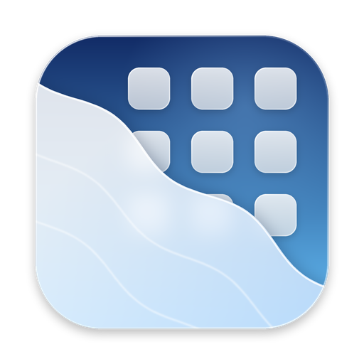
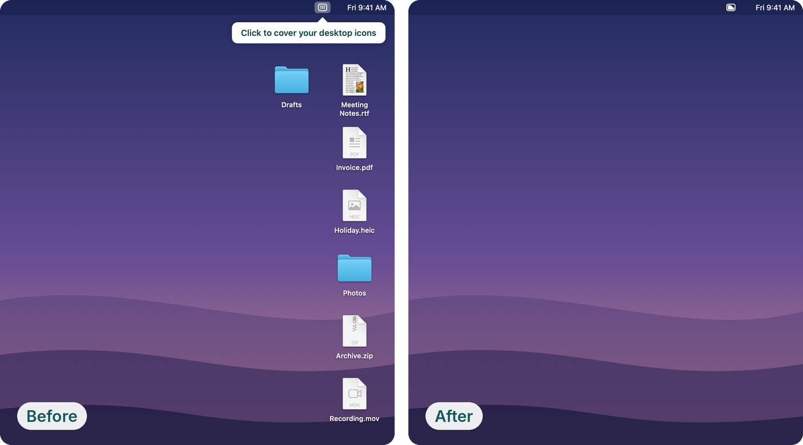

### `Desktopcloth`

Desktopcloth hides the icons on your Mac's desktop with one click, so screen shares, presentations and recordings show only your wallpaper.

  <a href="https://github.com/semicolonconsulting/desktopcloth/releases/latest">
    Download
  </a>
  •
  <a href="docs/guide.md">
    Documentation
  </a>
  •
  <a href="https://github.com/semicolonconsulting/desktopcloth/releases">
    Release Notes
  </a>
  •
  <a href="PRIVACY.md">
    Privacy
  </a>

 

### What it does

- **One click in the menu bar** covers every display, on every Space. Click again and your files are back.
- **Looks like your wallpaper**, even dynamic ones that change through the day, or a calm plain cloth if you prefer.
- **Changes nothing.** Your files aren't moved and no macOS settings are touched. It runs in the App Sandbox and collects no data.

### Install

Download the latest `.dmg` from [Releases](https://github.com/semicolonconsulting/desktopcloth/releases/latest), open it and drag Desktopcloth onto Applications. It needs macOS 13 Ventura or later, on Intel or Apple Silicon.

The first launch shows a "could not verify" message, because this copy isn't notarized. See [Install](docs/guide.md#install) for the one-time fix.

### Contributing

Bugs and ideas are welcome in [GitHub Issues](https://github.com/semicolonconsulting/desktopcloth/issues). To build the app yourself, see [Build from source](docs/building.md).

### License

MIT. See [LICENSE](LICENSE).
